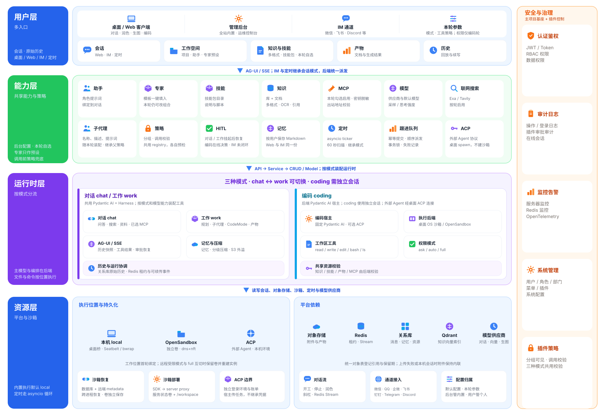

# 架构

本轮 `forwardedProps.agentMode` 选择对话（`chat`）、工作（`work`）或编码（`coding`）。`chat` 与 `work` 可在同一会话中切换，`coding` 与前两者不能互切，切换到编码需新建会话

三种模式共用身份、资源策略、消息持久化和运行租约，主模型与 Agent 编排均在后端执行。桌面的 `local` 指文件和命令的执行位置，不表示在桌面独立运行主模型或后端 Agent



## 分层与主链路

| 层次 | 目录或入口 | 职责 |
|---|---|---|
| API | `api/` | 路由、鉴权依赖、参数接收与响应，聊天使用 AG-UI 请求和 SSE 事件流 |
| Schema | `schema/` | 请求与响应 DTO、字段约束和协议扩展参数 |
| Service | `service/` | 资源归属、业务校验、运行派发及业务流程编排 |
| CRUD / Model | `crud/`、`model/` | 数据读写与 ORM 表定义，支持 MySQL 和 PostgreSQL |
| Agent 运行时 | `agent/work/`、`agent/coding/` | 对话与工作能力装配、编码宿主、模型历史、工具执行及运行生命周期 |
| 外部集成 | `provider/`、`channels/`、`agent/coding/protocol/` | 模型供应商、IM 网关、Pydantic AI 宿主及 ACP 协议边界 |
| 策略与公共能力 | `policy/`、`security/`、`utils/` | 调用策略、工具权限、审查、脱敏及共享转换能力 |

客户端经 API 进入 [ChatService](service/chat_service.py)，先校验会话、模式、工作位置和资源，再派发到对应运行时。`chat` 与 `work` 共用 `agent/work/`，由 [能力装配管线](agent/work/capability_pipeline.py) 控制差异；`coding` 进入独立编码宿主，并通过桌面桥、OpenSandbox 或 `acp_runner` 执行工具

数据库保存原始消息和业务记录，Redis 维护运行租约、取消标记、临时审批和事件重放。订阅断开不会主动停止生成；执行进程崩溃后，重放事件只能恢复展示，不能恢复已中断的命令或自动重做副作用

`executionBackend` 在首轮确定后写入 `turn_context`，续聊继承已有工作位置，显式变更会被拒绝。模式切换与工作位置绑定由 [ConversationService](service/conversation_service.py) 校验

## 部署与数据边界

| 组件 | 部署位置与职责 | 持久化边界 |
|---|---|---|
| fba 后端 | 运行 API、Service、模型请求、Agent 编排和 stdio MCP 子进程 | 关系库保存业务记录、原始消息、记忆和工作区登记，Redis 保存租约、取消标记、临时审批及事件流 |
| 桌面客户端 | 通过本机桥执行文件和命令操作，启动 ACP 外部 Agent | 本机工作目录、快照和账号隔离的离线历史缓存由桌面持有 |
| 服务端沙箱 | 默认使用 OpenSandbox，经后端 SDK 的 server proxy 调用；也可通过配置切换为 Docker、E2B、Modal、Daytona、Sprites、smolvm 或 BoxLite，均实现 Pydantic AI 的 `Workspace` | 数据库只登记对话当前使用的服务商与沙箱引用；沙箱内文件由服务商自己的磁盘保存，不做跨服务商迁移，重要产物应走 Git 或产物接口 |
| S3 | 保存附件、产物正文、工具结果外溢、测试报告和云端文件对象 | 业务表和统一对象表保存对象引用；上传失败时部分消息仍可保留内联载荷；本机会话附件不写入 |
| Qdrant | 保存知识库向量，按向量供应商和模型隔离集合 | 当前长期记忆检索返回 SQL 词法结果，不能据此宣称已启用向量记忆检索 |

[生命周期钩子](hooks.py) 启动 asyncio 协程处理残留消息收敛、定时任务、跟进队列和 IM 网关，这些任务不依赖 Celery。服务进程退出时关闭相应协程并清理运行

远程执行部署以 [Compose](deploy/docker-compose.yml)、[服务配置](deploy/config.toml) 和 [沙箱镜像](deploy/sandbox.Dockerfile) 为准。当前 SDK、server、execd 和 egress 配套版本为 `1.1.1`，执行镜像使用 Python 3.12 与 Node.js 22，并保留 npm、npx、Corepack 和 Yarn。后端启动的 stdio MCP 所需命令必须另行安装在后端环境，不能依赖沙箱内的命令

服务端沙箱遵循同一套生命周期：计算实例寿命较短，到期或空闲后由服务商暂停或停止，磁盘保留，下一轮按登记的引用接回；引用对应的沙箱已被删除时，直接建立新沙箱并更新登记，不静默沿用空环境。`ask` 与 `auto` 默认禁止出网，`full` 放宽出网，网络权限变化或服务商切换时销毁旧沙箱并重建，旧沙箱内文件不会迁移。通用适配见 [WorkspaceSandbox](agent/coding/workspace_sandbox.py)，服务商选择、接回、重建与销毁见 [沙箱服务商](agent/coding/sandbox_providers.py)

首次部署 OpenSandbox 时，在后端仓库根目录执行：

```bash
docker compose -f backend/plugin/ai_buddy/deploy/docker-compose.yml config --quiet
docker compose -f backend/plugin/ai_buddy/deploy/docker-compose.yml --profile image build ai_buddy_sandbox
docker compose -f backend/plugin/ai_buddy/deploy/docker-compose.yml up -d qdrant rustfs opensandbox-server
```

后端直接运行在宿主机时，OpenSandbox 地址使用 `127.0.0.1:8090`；后端运行在同机 Docker 容器时，使用 `host.docker.internal:8090`，Linux 上还需为后端容器添加 `host.docker.internal:host-gateway` 映射。Qdrant 与 S3 地址同样应从后端运行环境验证连通性

## 数据生命周期与同步

| 能力 | 实现 | 限制 |
|---|---|---|
| 统一对象注册 | <ul><li>附件、产物、知识、技能和工具输出登记在 <code>ai_buddy_object</code>，记录类型、位置、存储 ID 和摘要</li><li><code>ai_buddy_object_ref</code> 记录引用方，引用归零后进入墓碑，保留期结束才物理删除，期间出现新引用会恢复</li><li>回收接口默认只预览，每次删除留审计；可由 <code>AI_BUDDY_OBJECT_GC_INTERVAL_SECONDS</code> 开启定时回收</li></ul> | <ul><li>工作区文件仍由工作区清单管理，不进入统一对象表</li><li>历史聊天附件不补登记，因此不会被自动回收</li></ul> |
| 附件暂存与安全 | <ul><li>上传和远程下载先进入暂存区，被对话引用后才成为正式附件，超期未引用会被回收</li><li>远程下载只允许公网 http/https，限制重定向、大小和类型</li></ul> | <ul><li>以本机为准的会话附件保持内联，不上云</li></ul> |
| 会话同步 | <ul><li>用户消息带客户端 ID，相同内容重发返回冲突而不重复写入</li><li>增量接口按变更时间游标返回对话和消息变更，删除以墓碑返回</li><li>标题、置顶、归档、工作区和事实源修改使用修订号检测并发冲突</li><li>导入导出使用与部署无关的 JSON，附件内联；会话审计记录导出、导入、删除、迁移和首次同步</li></ul> | <ul><li>冲突不自动合并，由客户端提示后重试</li><li>离线队列在客户端实现</li></ul> |
| 会话事实源 | <ul><li>会话带 <code>source</code>，<code>cloud</code> 以云端为准，<code>local</code> 以本机为准</li><li>可在两者间迁移，会话行不变，ID、顺序、附件引用和删除状态保留</li></ul> | 目前只是声明和互迁，服务端仍保存本机会话的消息 |
| 运行恢复与观测 | <ul><li>可选步骤持久化保存事件、快照和工具副作用台账，只恢复快照与只读结果，不自动重放有副作用的命令</li><li>订阅支持按事件 ID 续传，事件日志在运行结束后保留 120 秒</li><li>运行与工具时限、重试次数统一配置</li></ul> | 步骤持久化目前只接入工作模式 |

删除对话时，消息软删除，步骤事件、快照和台账立即删除，附件只释放本对话引用，用户产物保留

## 通用

通用能力覆盖配置、对话、资源、安全与通道，各模式的运行差异在对应章节说明

| 功能 | 实现 | 限制 |
|---|---|---|
| **配置与资源** |  |  |
| 插件安装与生命周期 | <ul><li>插件安装器通过 ORM 创建缺失表，SQL 初始化菜单、AI 配置和内置资源；已有表通过 Alembic 迁移更新</li><li>启动时运行残留消息收敛、定时扫描、跟进队列和 IM 网关协程</li><li>退出时清理运行</li></ul> | <ul><li>采用应用级插件结构</li><li>依赖 <code>config</code> 和 <code>s3</code> 插件</li><li>数据库支持 MySQL 和 PostgreSQL</li></ul> |
| 全站配置 | <ul><li>后台配置搜索、审查、解析、向量、压缩、重试和默认执行后端</li><li>SQL 提供初始配置</li><li>动态配置覆盖静态默认值</li><li>缓存配置和向量配置指纹</li></ul> | — |
| 内置与个人资源归属 | <ul><li><code>user_id=0</code> 表示系统内置资源</li><li>客户端可使用内置资源和本人资源</li><li>个人写入绑定当前用户</li><li>后台维护内置资源</li></ul> | <ul><li><code>/me</code> 接口禁止修改内置资源</li><li>资源策略可进一步收窄可见范围</li></ul> |
| 供应商与模型管理 | <ul><li>后台维护全站供应商和模型</li><li>客户端可填写供应商、密钥和模型 ID，复用或创建个人供应商</li><li>保存模型类型、能力、输入模态、思考策略及上下文和输出上限</li><li>返回供应商凭据时脱敏</li></ul> | <ul><li>支持 OpenAI Chat 和 Responses</li><li>支持 OpenRouter</li><li>支持 Anthropic</li><li>支持 Google</li><li>支持 xAI</li></ul> |
| 模型发现与架构同步 | <ul><li>供应商模型列表仅发现标识与名称，不推断模型类型、能力或模态；模型配置由用户填写或通过 models.dev 同步</li><li>后台同步系统供应商模型，用户同步本人供应商模型；每次读取一次 models.dev 完整目录，包含归属范围内的禁用模型</li><li>同步后统一失效模型选项缓存</li></ul> | <ul><li>校验模型类型和供应商绑定</li><li>缺失或不适用的条目跳过，并返回原因</li><li>目录未提供的字段保留原值</li></ul> |
| 默认模型与选项缓存 | <ul><li>分别设置对话、向量和生图默认模型</li><li>本轮参数可覆盖默认模型</li><li>按用户缓存选项，资源变更时失效</li></ul> | <ul><li>全站默认模型仅绑定平台供应商</li><li>选项只包含当前用户可见且启用的资源</li></ul> |
| 快捷短语 | <ul><li>后台维护内置短语</li><li>客户端维护个人短语</li><li>支持标题、正文和排序</li></ul> | — |
| 助手角色 | <ul><li>保存内置或个人助手的名称、提示词和开场建议</li><li>新对话通过 <code>assistantId</code> 绑定助手</li></ul> | 对话和工作模式注入绑定助手的角色提示词 |
| 专家模板 | <ul><li>保存提示词和推荐资源</li><li>应用模板时可创建助手并预填本轮资源</li></ul> | 用户仍可修改预填的资源选择 |
| 项目与工作区引用 | <ul><li>项目保存名称、排序和归档状态，用于组织相关对话</li><li>首轮验证项目归属并绑定会话</li><li>对话、工作和编码每轮验证项目归属并注入项目名称</li><li>创建项目可创建本地目录或选择已有目录，保留项目与编码会话的目录绑定</li><li><code>workspaceRef</code> 引用知识、技能和产物</li><li>桌面宿主绑定本机目录</li></ul> | <ul><li>续聊使用会话已绑定的项目</li><li>项目写入仅接收名称、排序和归档状态</li><li>目录选择与执行权限沿用原有校验</li></ul> |
| 云端工作区清单 | <ul><li>按用户登记本机、云端和沙箱工作区</li><li>文件清单按相对路径进行 CAS 版本更新</li><li>上传按 SHA-256 内容寻址，下载复核摘要</li><li>本机文件由桌面持有，远程执行文件由所选沙箱服务商的磁盘保存</li></ul> | <ul><li>文件清理默认只预览</li><li>清理默认保留 24 小时宽限期，可通过配置调整</li><li>不自动删除用户工作目录</li></ul> |
| **对话、消息与媒体** |  |  |
| 对话管理 | <ul><li>支持列表、标题、置顶和归档</li><li>支持删除和按消息边界复刻</li><li>归档或删除前停止运行并处理队列</li><li>复刻复制消息和错误记录</li></ul> | — |
| 本轮输入与历史 | <ul><li>服务端解析本轮用户输入</li><li>数据库保存原始消息，作为历史权威来源</li><li>通过 <code>forwardedProps</code> 传入本轮执行选项</li><li><code>turn_context</code> 保存来源和部分本轮上下文</li></ul> | <ul><li>工作位置继承首轮且不能中途变更，其余选项按本轮解析</li><li><code>turn_context</code> 尚未完整记录全部执行选项</li><li>切换对话与工作模式或模型不改写原始历史</li></ul> |
| 用户消息引用定位 | <ul><li><code>forwardedProps.quote</code> 是业务扩展，保存引用定位锚点</li><li>发送与重生成前校验来源会话属于当前用户</li><li>锚点完整保存至 <code>turn_context.quote</code>，历史快照通过 <code>turnContext.quote</code> 返回</li></ul> | <ul><li>仅用于持久化和点击定位，不支持弹窗、批注或修改引用</li><li>未提供引用时不写入空 <code>quote</code></li></ul> |
| 后台生成、停止与重连 | <ul><li>对话、工作、编码和生图共用运行租约</li><li>数据库事务提交后激活后台任务，HTTP 订阅事件</li><li>断线后继续生成，重连可重放事件</li><li>停止请求设置取消标记</li><li>失效的待执行消息标记为中断</li></ul> | <ul><li>租约为 30 秒，每 5 秒续期</li><li>事件流保留约 20000 条事件</li><li>终态事件保留 120 秒</li><li>事件重放不能恢复已崩溃的执行进程</li></ul> |
| 持久跟进队列 | <ul><li>支持幂等提交、编辑、重排和移出</li><li>按顺序认领派发，派发时重查用户和权限</li><li>通过事务锁协调多进程</li><li>重启后继续扫描未完成队列</li></ul> | <ul><li><code>steer</code> 当前按排队处理</li><li>本机编码和 ACP 项必须具备有效的对应桌面连接；远程 OpenSandbox 不要求桌面桥</li></ul> |
| 消息重生成与错误终态 | <ul><li>对话和工作重发可覆盖最后一条用户输入</li><li>成功、错误或中断时更新助手占位消息</li><li>保存错误原因和详情</li><li>支持清空和删除消息</li></ul> | 编码重试必须由桌面重新提交执行参数和连接 |
| 聊天附件与生图结果 | <ul><li>AG-UI 接收图片、音频、视频和文档</li><li>二进制输入和生成图片优先保存到默认 S3</li><li>消息历史保存引用和媒体信息，推理或回放时还原</li></ul> | 保存失败时保留原始载荷，历史中可能仍包含内联内容 |
| 共享运行资源 | <ul><li>编码复用工作模式的记忆、搜索、计划、子代理和模型设置</li><li>三种模式共用知识、技能与产物读取，产物写入仅在工作和编码模式装配</li><li>ACP 由 Buddy 宿主检索资源后委托外部助手</li></ul> | <ul><li>编码记忆写入按本轮策略审批</li><li>子代理不能绕过父级写入策略</li><li>ACP 外部助手不继承 Buddy 的凭据和资源配置</li></ul> |
| 独立生图 | <ul><li>专用模型通过 <code>ImageGenerator</code> 接收提示词、参考图和图片参数</li><li>共用资源策略、后台生成、运行租约及消息保存流程</li></ul> | 不装配文本工作工具循环 |
| 草稿润色 | <ul><li>按钮和 <code>/polish</code> 共用 <code>POST /chat/polish</code></li><li>临时模型会话校验资源策略并返回润色文本</li></ul> | <ul><li>不占用对话生成租约</li><li>不写入对话历史</li></ul> |
| **知识、技能与产物** |  |  |
| 知识库与知识检索 | <ul><li>使用本地或远程向量模型对正文切片建立索引</li><li>按供应商和模型隔离向量集合</li><li>对话、工作和编码共用检索、正文读取及索引重建</li></ul> | 查询和返回结果均受资源可见性约束 |
| 文档解析与 OCR | <ul><li>支持文本、PDF、DOCX、PPTX 和 XLSX</li><li>支持图片、目录和 ZIP</li><li>可选内置解析、MarkItDown、Unstructured、MinerU、Doc2X 和 Mistral 等解析方式</li><li>无文字图片按配置回退 OCR</li><li>提取后的正文用于知识库</li></ul> | 原始上传文件不长期保存 |
| 本地向量与 OCR 模型 | <ul><li>提供模型目录、下载入口和状态</li><li>支持 FastEmbed 和 ONNX 向量模型</li><li>支持 RapidOCR 和 PaddleOCR</li><li>Tesseract 通过系统命令运行</li><li>PaddleOCR 可连接自建 API</li></ul> | <ul><li>本地运行前检查模型权重</li><li>权重下载到后端服务器的静态资源目录</li><li>下载状态和引擎缓存保留在进程内</li></ul> |
| 技能上传与读取 | <ul><li>解析目录或 ZIP 中的 <code>SKILL.md</code>，保留依赖文件</li><li>对话和工作模式构建时读取技能目录，加载时读取正文</li><li>编码模式列表不预读技能正文</li><li><code>read_skill_file</code> 分页读取包内文本</li></ul> | <ul><li>每次读取重新验证权限和路径</li><li>包内脚本不自动执行</li></ul> |
| 内置技能与管理工具 | <ul><li>随插件发布 <code>builtin_skills</code> 目录下的内置技能：<code>create-cron</code>、<code>create-assistant</code>、<code>create-expert</code> 和 <code>create-skill</code></li><li>启动后台协程在默认 S3 存储配置完成后写入系统技能；库中同名技能版本低于插件内置版本时先删除再重建，否则跳过；失败按间隔重试</li><li>对话和工作模式装配延迟加载的 <code>resource-tools</code> 能力，模型加载后才暴露 <code>list_resources</code>、定时任务的创建、暂停恢复和删除，以及助手、专家、技能的创建和修改工具</li><li>修改类工具只传需要改的字段，其余沿用现有值；技能原地改写 <code>SKILL.md</code>，技能 ID 和包内其他文件不变</li><li>专家创建和修改时校验新增的 MCP、技能和知识库对所有者可见，已有的历史引用不重复校验</li><li><code>create_cron</code> 返回下次执行时间和时区</li></ul> | <ul><li>写入、修改和删除类工具默认 <code>ask</code> 审批并纳入高风险判定，可由本轮工具策略覆盖；<code>list_resources</code> 只读</li><li>仅 <code>web</code> 来源装配；IM 尚无审批回调，定时任务触发的轮次无人值守，均不装配</li><li>子代理和编码模式不装配这些工具</li><li>定时任务只能绑定当前对话；已执行完毕的一次性任务不能再次启用</li><li>技能只生成 <code>SKILL.md</code>，技能名称不能修改</li><li>助手、专家和技能没有删除工具；创建前要求先在对话中确认草稿</li><li>重新生成消息沿用 <code>web</code> 来源</li></ul> |
| 产物保存与读取 | <ul><li>工作和编码共用产物创建、更新、列表及读取工具</li><li>文件产物和文本正文分别读取</li><li>修改标题不会创建空文本对象</li><li>登记云端文件时校验用户、工作区后端和文件清单</li><li>下载云端文件时比对登记摘要</li><li>S3 文本产物可下载为 Markdown</li><li>本机和沙箱文件提示在所属工作区打开</li><li>服务端沙箱文件通过 <code>deliver_file</code> 交付：读取字节后存入当前用户的云端交付工作区，登记为 S3 文件产物，路径含内容摘要，沙箱回收后聊天记录中的产物仍可下载</li></ul> | <ul><li>编码写产物和交付文件受工具审批</li><li>交付仅限服务端沙箱，单文件不超过 <code>S3_UPLOAD_SIZE_MAX</code>，依赖目录、<code>.git</code>、<code>inbound</code> 和内部目录不可交付</li><li>登记后的摘要、大小和 MIME 不可直接修改</li><li>文件变化导致摘要不一致时返回冲突</li><li>当前不归档产物历史版本</li></ul> |
| **MCP、安全与资源策略** |  |  |
| MCP 定义与调用 | <ul><li>支持导入配置和测试连接</li><li>按本轮 <code>mcpIds</code> 装配已选 MCP</li><li>支持 stdio、SSE 和 Streamable HTTP</li><li>工具增加前缀以避免命名冲突</li><li>对话和工作模式延迟揭示工具，编码模式绑定宿主工具</li><li>返回 MCP 凭据时脱敏</li></ul> | stdio 进程由后端服务器启动 |
| MCP 交互应用 | <ul><li>校验会话归属、本轮 MCP 选择和工具 UI 声明</li><li>读取 HTML 应用并返回工具结果</li><li>随工具结果保存应用来源引用</li></ul> | <ul><li>只允许调用对应用开放的工具</li><li>非只读调用必须获得本次批准</li></ul> |
| 脱敏、Jev 与内容过滤 | <ul><li>工作输入、输出和工具文本进行密钥及个人信息脱敏</li><li>配置密钥后，Jev 审查输入和高风险工具</li><li>工作审查可放行、拒绝或要求人工确认</li><li>供应商内容过滤转为错误终态</li></ul> | <ul><li>子代理和编码将 Jev 的 <code>ask</code> 视为拒绝</li><li>展示脱敏不等于资源密钥静态加密</li></ul> |
| 工具参数修复 | <ul><li><code>RepairToolArguments</code> 修复工具 JSON 参数</li><li>工作循环、子代理和编码宿主共用</li><li>修复结果随工具调用写入模型消息</li></ul> | 修复发生在当前调用内 |
| 通用资源策略与分组 | <ul><li>对话、工作、编码、润色和生图共用调用前校验</li><li>多个策略串行执行</li><li>可选 <code>ai_buddy_group</code> 插件注册分组规则并过滤资源列表</li><li>同一调用通过 ContextVar 共享查询结果</li></ul> | 任一策略拒绝即拒绝调用 |
| 审批审计 | <ul><li>工作延迟审批和编码在线审批均记录申请、决策、取消及过期</li><li>审计按用户和对话隔离</li><li>设置页可查询本人记录</li><li>临时审批状态用于运行恢复，数据库审计用于持久记录</li></ul> | 审计写入失败时，阻止需审批的工具继续执行 |
| MCP OAuth | <ul><li>超级管理员在后台统一配置内置 MCP 的 OAuth 客户端</li><li>客户端用户只连接或断开本人账号</li><li>使用 PKCE 和一次性 state</li><li>平台客户端密钥与个人令牌分表加密保存</li><li>按用户和 MCP 隔离令牌</li><li>通过刷新锁、平台配置版本和个人连接版本 CAS 防止旧请求恢复令牌</li><li>对话、工作、编码和 MCP 应用共用当前用户令牌</li></ul> | <ul><li>仅支持 HTTPS 远程内置 MCP</li><li>服务商实际注册和回调仍需部署验证</li></ul> |
| MCP HTTP 出站校验 | <ul><li>校验 HTTP MCP 的 URL、全部 DNS 结果、实际连接地址和重定向</li><li>连接已校验的数字地址</li><li>关闭环境代理</li></ul> | 不覆盖所有供应商、搜索和附件请求 |
| **通道** |  |  |
| 通道配置与扫码绑定 | <ul><li>客户端维护本人通道、凭据和展示开关</li><li>微信、QQ、企微、飞书和钉钉支持扫码绑定</li><li>其他通道手动填写凭据</li><li>二维码有效期采用平台返回值</li></ul> | 扫码临时状态保留 600 秒 |
| 斜杠指令 | <ul><li>提供独立 HTTP 目录和执行入口</li><li>通用指令包含 <code>help</code>、<code>status</code>、<code>new</code>、<code>stop</code>、<code>compact</code>、<code>retry</code> 和 <code>title</code></li><li>Web 额外提供 <code>polish</code></li><li>IM 额外提供 <code>list</code> 和 <code>switch</code></li><li><code>title</code> 从消息提取标题预览</li></ul> | <ul><li><code>compact</code> 删除旧数据库消息</li><li><code>retry</code> 支持对话和工作轮，编码轮需由桌面重新提交</li><li><code>polish</code> 不写历史</li></ul> |
| IM 入站与审批卡片 | <ul><li>统一处理微信、QQ、企微、飞书、钉钉、Telegram 和 Discord 入站载荷</li><li>将外部身份映射为用户，并关联对话和消息</li><li>按通道开关过滤输出</li><li>为待确认调用构造审批卡片数据</li></ul> | <ul><li>继承会话模式，未设置时使用 <code>work</code>；编码运行仍需满足执行连接要求</li><li>审批卡片尚无平台投递和点击回调闭环</li></ul> |
| 对话定时任务 | <ul><li>本人对话支持 <code>cron</code>、<code>interval</code> 和 <code>date</code> 触发方式</li><li>支持立即运行和新建对话</li><li>服务每 60 秒扫描任务，通过锁防止重复执行</li><li>以用户上下文继承目标会话模式派发运行，新线程继承原会话模式，并保存最近运行结果</li></ul> | <ul><li>消费事件流时检查 <code>RUN_ERROR</code>，取消或异常记录失败；不自动准备本机编码或 ACP 连接</li><li>创建时每个用户最多启用 10 个任务，<code>interval</code> 不小于 60 秒，<code>date</code> 必须晚于当前时间</li></ul> |

挂载能力提供指令、工具定义和运行钩子，业务工具由模型提出调用后执行。后端使用 Pydantic AI 2.60.0 和 Harness 0.60.0，配套桌面通过后端运行对话、工作与编码宿主，本机桥负责文件、命令和 ACP 进程

通用能力的调用时机与处理边界如下

| 功能 | 实现 | 限制 |
|---|---|---|
| 技能加载与恢复 | <ul><li><code>load_capability</code> 读取指定 <code>SKILL.md</code> 并重验权限</li><li>技能说明进入工具结果历史</li><li>续聊通过原生消息历史恢复已加载状态</li></ul> | 同轮后续模型请求不重复读取已加载技能正文 |
| 显式工作区引用 | <ul><li>构建时读取用户选中的技能、知识和产物正文并注入</li><li>其余资源通过工具按需读取</li></ul> | 知识和产物初始注入最多 4000 字符 |
| 记忆注入 | <ul><li>每个模型请求前读取当前用户默认 <code>MEMORY.md</code> 和有界文件目录</li><li>其他正文由 <code>read_memory</code> 或 <code>search_memory</code> 读取</li></ul> | 不向模型暴露物理存储路径 |
| 知识检索 | <ul><li><code>search_knowledge</code> 调用时检查索引、补建缺失索引并检索</li><li>返回结果前重验资源可见性</li><li><code>get_knowledge</code> 调用时读取指定正文</li></ul> | 补建缺失索引可能增加本次检索延迟 |
| 工具调用 | <ul><li>编码宿主和本机桥先校验 JSON Schema 参数，再审批，最后执行处理器</li><li>工作工具在 <code>before_tool_execute</code> 执行策略校验</li></ul> | 工作工具的 <code>ask</code> 挂起后，必须通过审批结果恢复 |
| 工具返回 | <ul><li>字符串结果先清洗，再应用工具输出限制</li><li>较大结果保存外溢引用</li><li><code>read_tool_result</code> 按需读取外溢内容</li></ul> | <ul><li>结构化非字符串结果维持现有放行契约</li><li>外溢读取仅限当前用户范围</li></ul> |
| 模型文本展示 | <ul><li>完整文本段结束后统一脱敏再发送</li><li>避免密钥和个人信息跨流式分片漏出</li><li>异常或中断消息在提取持久化文本时再次清洗</li></ul> | <ul><li>文本按完整段发送</li><li>展示脱敏不代表所有数据入库前均已脱敏</li></ul> |
| 结束与续聊 | <ul><li>成功、异常和取消都保留已执行的工具历史并释放连接</li><li>中断调用补充终止结果</li><li>续聊用历史重建已加载状态和待审批调用</li></ul> | 不自动重做已执行或中断调用的副作用 |

带供应商签名的推理内容在内部 SDK 历史中保留原文和签名，以便重放。实时展示与工作历史快照使用脱敏副本，无签名推理可直接清洗。用户原始输入仍按既有消息保存流程存储

桌面的 `local` 表示本机编码执行后端。主模型、历史、共享资源和审批仍由服务端运行，文件和命令通过桌面桥在用户电脑执行。`history.sqlite` 仅提供按账号隔离的离线只读历史缓存，当前没有独立的本机 Agent 运行模式

### 用户消息引用定位

`forwardedProps.quote` 保留为业务扩展，不定义 AG-UI 原生 quote 类型，发送后仅用于持久化和点击定位

| 字段 | 约束 | 用途 |
|---|---|---|
| `messageId` | 必填，1–256 字符 | 来源渲染消息 ID |
| `text` | 必填，1–8000 字符 | 选中的原文 |
| `conversationId` | 可选，最长 64 字符 | 来源会话，提供时必须属于当前用户 |
| `occurrence` | 可选，非负整数 | 相同原文的出现序号 |
| `start` / `end` | 可选，非负整数，同时提供时 `end >= start` | 来源消息中的选区起止偏移 |
| `prefix` / `suffix` | 可选，各最长 64 字符 | 选区前后的定位文本 |

发送链路将所有已提供的锚点字段按上述名称保存至 `turn_context.quote`，历史接口通过消息的 `turnContext.quote` 完整返回；未提供 quote 时不写入该键

引用原文由前端放入 AG-UI `context[]`，对话与工作运行时通过 `instructions` 提供给模型，后端不将 `forwardedProps.quote` 再转换成模型消息

用户引用不提供批注、弹窗或修改接口。AI 回复中的 `fba-citation://v1` 链接仅由前端 Markdown 渲染器处理，后端不解析或扩展该协议

### MCP OAuth 后台与客户端接入

超级管理员统一管理内置 MCP 的 OAuth 客户端配置，用户只连接或断开本人账号。平台配置与个人令牌分表加密保存，平台配置版本和个人连接版本共同保护授权回调及令牌刷新

接入实现见 [MCP OAuth 服务](service/mcp_oauth_service.py)

## 对话模式

`chat` 面向问答、讨论和轻量起草，与 `work` 共用 AG-UI、模型适配、历史、助手角色、记忆、压缩和资源策略

| 能力 | `chat` | `work` |
|---|---|---|
| 搜索、知识与技能读取、产物读取、已选 MCP | 按模型能力与本轮参数装配 | 按模型能力与本轮参数装配 |
| 内置产物写入工具 | 不装配 | 装配并遵循工具策略 |
| Planning、子代理、CodeMode | 不装配 | 按能力装配 |
| 主动提问、顾问与工作提醒 | 不装配 | 按能力装配 |
| 通用 Shell 和项目磁盘工具 | 不提供 | 不提供，实际仓库操作需新建编码会话 |

`chat` 不等于所有工具都只读：用户已选择的 MCP 和记忆工具仍遵循各自权限与审批策略。内置能力差异以 [能力管线](agent/work/capability_pipeline.py) 和 [资料与产物工具装配](agent/work/capabilities/workspace_tools.py) 为准

## 工作模式

| 功能 | 实现 | 限制 |
|---|---|---|
| 工作消息协议 | <ul><li>使用 AG-UI 协议接收多模态输入、共享状态和前端上下文</li><li>支持前端工具、历史快照和能力事件</li><li>通过 SSE 推送运行事件，持久保存模型消息和待执行的前端工具标识</li><li>从运行请求恢复审批结果和前端工具结果，复用原用户消息</li></ul> | 运行中的规划、子代理、压缩和提问活动事件最多保留 500 条 |
| 子代理目录与执行 | <ul><li>保存子代理名称、描述和提示词</li><li>执行时独立装配知识、产物和时间工具</li><li>继承父代理工具策略，将执行结果返回主对话</li></ul> | 需要用户确认的操作交回主代理处理 |
| 模型、思考与采样 | <ul><li>校验模型归属和能力，解析本轮指定模型或默认模型</li><li>按供应商映射思考、温度、采样和输出上限</li><li>运行结束时关闭本轮模型客户端</li></ul> | 模型支持工具时才装配工具能力 |
| 工作上下文与目标提醒 | <ul><li>注入办公约束、角色、项目名称和对话目标</li><li>每 6 次模型请求提醒办公约束</li><li>每 4 次模型请求重申目标</li><li><code>GoalReanchor</code> 重申本轮首条输入</li><li>提供缓存失效和用量提醒</li></ul> | 提醒在压缩后注入当前运行上下文，不写入持久历史 |
| 联网搜索、抓取与时间 | <ul><li>按模型能力选择原生搜索或 Exa、Tavily、DuckDuckGo 后备搜索</li><li>提供时间工具</li><li>根据模型能力装配 WebFetch 和 XSearch</li></ul> | <ul><li>搜索受全站配置和本轮参数控制</li><li><code>webSearch=off</code> 只关闭指定搜索分支</li><li>WebFetch 和 XSearch 仅部分模型支持</li></ul> |
| 研究引用 | <ul><li>搜索卡保留搜索服务返回的真实标题、摘要和原文链接</li><li>从模型原生响应注解提取引用，实时推送并在历史快照中展示</li><li>编码模式搜索共用同一引用契约</li></ul> | <ul><li>仅显示安全的 HTTP(S) 链接</li><li>不从回复正文猜测引用来源</li></ul> |
| CodeMode / Monty | <ul><li>通过 <code>run_code</code> 使用受限 Python 编排已授权业务工具</li><li>默认使用 <code>eager</code> 执行方式</li><li>取消时清理未采用的推测查询</li><li>业务工具继续遵循各自的持久化规则</li></ul> | <ul><li>不能访问项目目录、通用 Shell 或任意第三方库</li><li><code>speculate</code> 仅允许提前执行 <code>search_knowledge</code>、<code>get_knowledge</code>、<code>list_artifacts</code> 和 <code>get_artifact</code></li><li>审批和 Jev 保留普通工具边界，并关闭相应的提前执行</li></ul> |
| Planning | <ul><li>管理子任务及状态，历史接口可读取计划</li><li>复刻或删除对话时同步处理计划</li><li>按用户和对话隔离保存计划</li></ul> | <ul><li>计划闲置 7 天后过期</li><li>缺少用户或对话标识时仅使用本轮默认存储</li></ul> |
| 长期记忆 | <ul><li>按用户隔离保存 Markdown 逻辑文件</li><li>支持读写、版本 CAS、幂等回执和检索</li><li>Web 与 IM 中的同一用户共享记忆</li></ul> | <ul><li>仅接受无目录的 Markdown 文件名</li><li>检索实际返回 SQL 词法结果，Qdrant 查询未参与返回</li><li>当前未注入项目专用记忆</li></ul> |
| 自动分级压缩 | <ul><li><code>TieredCompaction</code> 依次清理工具结果、去重读取、裁剪滑动窗口并生成摘要</li><li>按上下文窗口触发，客户端可关闭</li><li>在助手消息中保存压缩活动记录</li></ul> | <ul><li>自动压缩只更新运行上下文，不改写数据库中的原始历史</li><li>显式执行 <code>/compact</code> 会删除旧数据库消息</li></ul> |
| 顾问与中途纠偏 | <ul><li>将 <code>advisorModel</code> 解析为当前供应商下启用且可见的聊天模型，并校验调用策略</li><li>本地顾问共享本轮已配置的客户端、凭据和服务地址，并接收转发的历史</li><li>Judge 使用本轮主模型及其凭据</li></ul> | <ul><li>不回退到环境变量中的密钥</li><li>拒绝隐式选择其他供应商的模型</li></ul> |
| 工具策略与工作审批 | <ul><li>优先应用显式 <code>toolPolicies</code> 中的 <code>allow</code>、<code>ask</code> 和 <code>deny</code> 策略</li><li><code>ask</code> 通过 <code>DeferredToolRequests</code> 挂起旧运行，并保存待确认调用</li><li>批准后由 AG-UI <code>resume</code> 启动新的恢复运行，复用原用户消息</li></ul> | <code>mcpApproveWrites</code> 将未被显式策略覆盖的 MCP 工具默认设为询问，不根据只读声明判断写入 |
| 主动提问 | <ul><li><code>ask_user</code> 支持文本、单选和多选问题</li><li>校验对话归属，仅接受当前运行的一次答复</li><li>取消、过期或运行结束时返回 <code>cancelled</code></li></ul> | <ul><li>一次最多提出 10 个问题</li><li>不得索取密钥</li><li>待答请求 30 分钟过期</li><li>公开事件与恢复接口不包含答案</li></ul> |
| 工具输出外溢 | <ul><li>结果达到 10000 字符或二进制字节时，将完整内容保存至默认 S3，并在消息中保留引用</li><li>按用户隔离引用并进行哈希，避免不同调用出现路径清洗碰撞</li><li>保存失败时保留原文</li></ul> | <ul><li>仅在模型支持函数工具且默认 S3 可用时启用</li><li>只能读取当前用户的对象引用</li></ul> |

工作 Agent 的装配与请求时机如下

| 功能 | 实现 | 限制 |
|---|---|---|
| 工作 Agent 构建 | <ul><li>校验本人可见的供应商、模型及调用策略</li><li>按模型能力装配 Agent</li><li>读取助手、项目、目标和技能目录</li></ul> | 构建时不批量读取技能正文 |
| 工作 MCP 挂载 | <ul><li>在运行初始化和收集工具时连接已选 MCP，并读取工具目录</li><li>模型通过搜索揭示工具定义后提出调用</li></ul> | 工具定义延迟揭示不等于延迟连接 MCP |
| 请求前钩子 | <ul><li>先压缩并更新本轮模型上下文</li><li>再向当前请求注入提醒和记忆</li><li>在每次模型请求前准备模型设置和工具定义</li></ul> | — |

## 编码模式

编码助手分为内置助手与 ACP 外部助手，两类助手均由服务端的 Buddy Pydantic AI 宿主运行

内置助手选择本机 `local` 或服务端 `sandbox` 执行后端，ACP 外部助手通过桌面连接已安装的 Agent

| 功能 | 实现 | 限制 |
|---|---|---|
| 编码宿主与能力 | <ul><li>装配编码约束、项目、目标、权限、Thinking、参数修复、Jev 和共享资源能力</li><li>接收 AG-UI 多模态输入并保存原始附件，普通文件通过元数据和预览进入模型，再由 <code>import_attachment</code> 写入工作区</li><li>历史附件仅转换为模型上下文，不改写数据库历史，也不复用本轮附件编号</li><li><code>git_status</code> 和 <code>git_diff</code> 使用固定只读命令，协商 <code>workspace_git_v1</code> 后支持宿主授权的 Worktree 操作</li></ul> | <ul><li>宿主固定使用 Pydantic AI，模型必须支持工具调用</li><li>本机执行不改变主模型在服务端运行的位置</li><li>Git 检查禁用外部程序和配置 include</li></ul> |
| 编码历史压缩 | <ul><li>每轮进入模型循环前修复供应商消息，并执行一次压缩检查</li><li>达到阈值后先清理工具结果，再使用滑动窗口保留首条用户消息和完整工具调用对</li><li>支持本轮关闭压缩，或覆盖保留消息数和触发消息数</li></ul> | <ul><li>工具返回后不重复执行压缩检查</li><li>压缩只改变本轮模型上下文，不改写数据库原始历史</li><li>切换供应商不破坏原始历史</li></ul> |
| 编码执行选择 | <ul><li>首轮根据默认配置或用户选择确定 <code>executionBackend=local/sandbox</code>，服务端沙箱再由 <code>sandboxProvider</code> 选择服务商，出厂默认使用 <code>local</code>，续聊继承首轮工作位置</li><li>选择 ACP 时使用独立 ACP 连接</li></ul> | <ul><li><code>local</code> 必须具备有效桌面桥，否则拒绝执行</li><li>会话开始后不能更改工作位置，切换需新建会话</li><li>ACP 不创建内置沙箱</li></ul> |
| 桌面 OS 沙箱执行桥 | <ul><li>JWT 创建一次性票据，WebSocket 首帧认证后通过 RPC 执行文件和命令操作</li><li>校验连接与会话的用户、权限一致</li><li>未指定项目目录时，在 <code>~/.fbabuddy/YYYY/MM/DD/task_&lt;conversation&gt;_&lt;account&gt;/</code> 创建独立工作区，并建立 <code>inbound</code>、<code>outbound</code>、<code>tmp</code> 和 <code>.fbabuddy</code> 目录</li><li>显式指定目录时保持原路径</li><li>每轮结束通知桌面关闭并撤销连接</li></ul> | <ul><li>连接只供单个会话占用</li><li>票据有效期 120 秒</li><li>连接最长 1 小时</li><li>存活标记有效期 30 秒</li><li>路径与进程隔离由配套桌面实现，Seatbelt 和 bwrap 实现不在本仓库</li><li>不提供桌面 HTTP 隧道</li></ul> |
| 服务端沙箱 | <ul><li>按对话登记服务商与沙箱引用，同一服务商下优先接回，已暂停的实例自动恢复</li><li>客户端通过 <code>sandboxProvider</code> 在受支持的服务商中选择，默认值由 <code>AI_BUDDY_AGENT_SANDBOX_PROVIDER</code> 决定，非 OpenSandbox 的服务商按需安装 <code>pydantic-ai-harness</code> 对应扩展</li><li>切换服务商、网络权限变化或沙箱丢失时，销毁旧沙箱并在目标服务商上重建</li><li>删除对话时按登记销毁沙箱</li><li>后台命令通过工作区内的日志与退出文件实现，不依赖服务商私有接口</li></ul> | <ul><li>旧沙箱内的文件不会迁移到新服务商</li><li>只有通过 <code>deliver_file</code> 交付的文件会持久保存，其余沙箱文件随沙箱回收</li><li>通用适配不提供端口访问，需要预览服务时使用 OpenSandbox</li><li>中断的命令不会自动重放</li><li>各服务商的寿命与空闲回收由其自身配置决定，不由本插件管理</li></ul> |
| 文件、命令与工程视图 | <ul><li><code>read/write/edit/bash/ls</code> 检查路径、大小、唯一替换和命令超时，并提供知识、技能与产物工具</li><li>统一工程入口展示 Git 状态与差异、测试报告、整轮快照、恢复和提交前检查</li><li>内置助手与 ACP 均在执行前后捕获本机快照，工作文件和快照保存在本机工作区</li></ul> | <ul><li>只读检查不暂存或提交</li><li>同目录执行和恢复互斥</li><li>快照排除 <code>.git</code> 和依赖目录，并展示遗漏项</li><li>快照单文件上限为 2 MiB</li><li>快照单轮总量上限为 64 MiB</li><li>快照最多覆盖 10000 条目</li><li>快照不能恢复工作目录以外或超限的文件</li></ul> |
| 桌面 Worktree | <ul><li>从选定分支或提交创建 Worktree，托管创建默认建立 <code>buddy/worktree-*</code> 分支，底层同时支持 detached；绑定同账号的对话并验证真实路径和 Git 双向指针</li><li>托管工作文件默认保存在 <code>~/.fbabuddy/Worktrees/&lt;repo-name&gt;/&lt;profile-key-sha256 前 24 位&gt;/</code>，也可显式指定目标目录，应用保留账号、对话与源仓库的绑定和恢复信息</li><li>内置助手与 ACP 共用绑定目录，切换助手保持原 cwd</li><li>ACP 准备凭据一次性消费后重新校验</li><li>支持恢复未发送草稿，并通过原生选择器验证后接回遗留目录</li></ul> | <ul><li>创建时按 <code>copyChanges</code> 复制未提交修改</li><li>删除聊天不删除文件</li><li>托管清理默认拒绝包含未提交修改、忽略文件或新增提交的目录，显式强制清理由独立参数控制</li><li>导入目录不自动删除</li></ul> |
| 测试命令与报告 | <ul><li>内置助手的 <code>run_tests</code> 接收明确命令，复用现有执行器与审批，保留实际退出码、终止原因、时长和捕获输出</li><li>远程执行使用 OpenSandbox SDK 事件</li><li>命令执行状态与报告归档状态分开展示</li><li>Markdown 报告归档到 S3，包含运行与工作区标识、请求命令、实际命令和捕获输出，并通过报告 ID 关联对话工具历史</li><li>用户显式下载后将报告保存到本机</li></ul> | <ul><li>桌面连接必须同时声明 <code>run_tests_v1</code>、<code>workspace_git_v1</code> 和 <code>input_files_v1</code></li><li>不推断测试用例数</li><li>聊天输出预览最多 12000 字符</li><li>报告捕获输出最多 512 KiB</li><li>归档失败不重跑命令</li><li>取消或连接丢失时执行结果可能未知</li><li>取消后在限定范围内尽力归档已捕获的输出</li><li>不归档超限日志和连接丢失后未捕获的日志</li></ul> |
| 编码权限与在线审批 | <ul><li><code>ask</code> 默认确认写文件、编辑、<code>bash</code>、写产物和 MCP 调用</li><li><code>auto</code> 和 <code>full</code> 自动允许默认可变更工具</li><li>内置沙箱在 <code>full</code> 下保留隔离并放宽出网</li><li>审批接口校验会话归属，Lua 校验运行归属与取消状态</li><li>运行在线等待审批，批准后在同一个 run 中继续执行</li></ul> | <ul><li>显式 <code>deny</code> 在自动权限模式下仍然生效</li><li>审批状态有效期为整轮超时加 60 秒，运行结束后清理</li></ul> |
| ACP 本机连接与检测 | <ul><li>桌面启动已安装的外部 Agent，继承本机登录环境，后端通过独立桥转发 stdio</li><li>预设支持 OpenCode、CodeBuddy、Claude Code、Codex、Kimi Code、Cursor CLI 和 Pi</li><li>外部 Agent 的文件保存在其桌面目录</li></ul> | <ul><li>检测仅验证协议握手和会话创建</li><li>票据有效期 120 秒</li><li>连接最长 1 小时</li><li>存活标记有效期 30 秒</li></ul> |
| ACP 委托与权限 | <ul><li>Buddy 宿主检索共享资源后，通过 <code>acp_runner</code> 写入任务并委托外部 Agent</li><li>保存本轮原始附件，桌面导入当前工作区后提供文件路径</li><li>按 <code>promptCapabilities</code> 发送原生媒体，超过内联预算或不受支持的附件使用已验证摘要的本机导入记录</li><li><code>ask</code> 使用编码审批，记录原生 <code>stop_reason</code> 和外部 Agent 上报的 <code>usage</code></li><li>同一 Buddy 轮内复用 ACP 会话，轮末关闭会话和所属进程</li><li>下一轮由 Buddy 历史和持久工作文件承接</li></ul> | <ul><li>外部 Agent 不继承 Buddy 凭据、MCP、知识或额度</li><li>外部账单独立</li><li>附件内联预算为 5 MiB</li><li>取消、拒绝或额度耗尽时不宣称任务完成</li><li>不保证外部 Agent 内部会话跨轮延续</li></ul> |

编码宿主初始化 MCP 的时机如下

| 功能 | 实现 | 限制 |
|---|---|---|
| Coding MCP | <ul><li>建立 MCP 会话时读取完整分页目录，并过滤仅供应用使用的工具，其余定义直接暴露给模型</li><li>初始化取消时关闭已经进入的资源</li></ul> | <code>call_tool</code> 仅在模型调用且通过策略后执行 |
