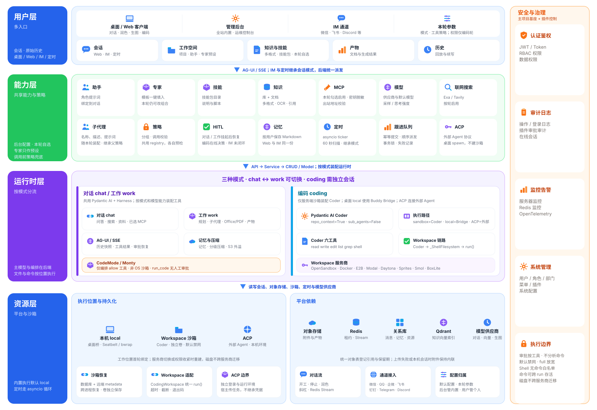

# AI Buddy 架构

AI Buddy 是 `fastapi-best-architecture` 的应用级插件，为 Web、桌面端和 IM 提供对话、工作与编码能力。本文说明系统边界、Pydantic AI 能力层、请求生命周期、运行状态和安全约束。

`forwardedProps.agentMode` 决定本轮模式：

- `chat`：问答、讨论、搜索和轻量起草
- `work`：规划、子代理、文档处理、产物生成和 MCP
- `coding`：面向仓库的文件、命令、测试和 ACP 外部 Agent

`chat` 与 `work` 可在同一会话中切换；切换到 `coding` 必须新建会话。三种模式共用身份、资源策略、消息持久化和运行租约。主模型、Agent 编排和审批始终在后端执行，桌面端的 `local` 只表示文件和命令在用户电脑执行。

能力装配以 [CapabilityRegistry](agent/capabilities/capability_registry.py) 为唯一注册来源：每个构建器只注册一次并声明可用模式，`chat`、`work`、`coding` 通过 profile 选择与排序。`chat/work` Agent 与编码宿主共用这套注册与装配规则。



## 1. 设计边界

| 边界 | 约定 |
|---|---|
| 模式 | `chat` 与 `work` 共享工作会话，`coding` 使用独立会话 |
| 模型 | 由后端选择模型并调用供应商，不在桌面端独立运行主模型 |
| Agent | Agent 构建、能力装配、工具循环和历史管理均在后端完成 |
| 执行位置 | `local`、OpenSandbox 等服务端沙箱、ACP 外部 Agent 只决定工具在哪里执行 |
| 状态 | 关系库保存业务与历史，Redis 保存临时运行状态，S3 保存对象正文，Qdrant 保存知识向量 |
| 切换 | `chat` 与 `work` 可切换；`coding` 不能与两者互切；`executionBackend` 首轮确定后锁定 |

## 2. 总体架构

```text
Web / Desktop / IM
        |
        v
FastAPI API  ->  ChatService  ->  ConversationService
                       |
          +------------+------------------+
          |                               |
          v                               v
 chat / work                       coding
 AgentSession                      Pydantic AI 编码宿主 / ACP
          \                               /
           +------ CapabilityRegistry ----+
                          |
                 chat / work / coding profile
                          |
               CapabilityPipeline 运行时装配
                          |
        +-----------------+------------------+
        |                 |                  |
  Model Provider    Tools / MCP      Workspace / Sandbox
        |                 |                  |
        +---------- Pydantic AI Agent --------+
                          |
                 AG-UI / SSE / History
```

| 层 | 入口 | 职责 |
|---|---|---|
| 接入层 | `api/`、`schema/` | 鉴权、DTO、AG-UI 请求和 SSE 响应 |
| 业务层 | `service/` | 会话、模式、资源归属、运行派发和审批 |
| Agent 层 | `agent/work/`、`agent/coding/` | Agent 构建、能力装配、工具循环和历史 |
| 能力层 | `agent/capabilities/capability_registry.py` | 能力注册、模式过滤、profile 排序和组合状态 |
| 模型层 | `provider/` | 供应商适配、模型创建和能力映射 |
| 资源层 | `crud/`、`model/`、`policy/`、`security/` | 数据、策略、审查、脱敏和对象管理 |
| 执行层 | Workspace、桌面桥、OpenSandbox、ACP | 文件、命令、测试和外部 Agent |

客户端经 [ChatService](service/chat_service.py) 进入。`chat` 与 `work` 共用 [能力装配管线](agent/capabilities/capability_pipeline.py)，`coding` 进入 [Pydantic AI 编码宿主](agent/coding/protocol/pydantic_ai/session.py) 或 [ACP 服务](agent/coding/protocol/acp/service.py)。三者都从 [CapabilityRegistry](agent/capabilities/capability_registry.py) 获取对应 profile；`chat/work` 的管线负责追加跨模式运行时能力和最终顺序，`coding` 的宿主负责追加工具预过滤与资源策略钩子。

## 3. Pydantic AI 能力

本节只说明项目实际接入的 Pydantic AI 能力，不复制上游全部 API。

### 3.1 能力分层

| 层 | 职责 | 代表实现 |
|---|---|---|
| Provider | 统一模型客户端，吸收供应商参数和响应差异 | `ProviderAdapter`、`ProviderRegistry` |
| Agent | 创建 Pydantic AI `Agent`，注入指令、依赖、历史和模型 | `AgentSession.build_agent` |
| Capability | 按 profile 组合工具、钩子、提醒、压缩、安全策略和每步工具暴露 | `CapabilityRegistry`、`CapabilityAssembly`、`CapabilityPipeline`、`PrepareTools` |
| Harness | 提供可复用的高阶 Agent 行为 | `SubAgents`、`Planning`、`CodeMode`、`StepPersistence` |
| Workspace | 统一文件、命令和沙箱操作 | `Workspace`、`WorkspaceSandbox` |
| Protocol | 转换 AG-UI、ACP、模型消息和流式事件 | `AGUIAdapter`、ACP Service |

Pydantic AI 在本项目中不仅用于调用模型，还负责完整 Agent 循环：模型请求、工具调用、工具结果回填、消息历史和运行事件都由此层驱动。

### 3.2 Agent 构建流程

1. 业务层校验用户、会话、模式、项目、资源和执行后端。
2. `ProviderAdapter` 读取供应商、密钥、模型类型和限制，创建 Pydantic AI 模型。
3. `AgentSession` 注入角色、工作上下文、目标、依赖和历史，构建 `Agent`。
4. `resolve_capability_mode` 解析本轮 profile，`build_profile_capabilities` 从 `CAPABILITY_REGISTRY` 选出构建器并依次执行。
5. 构建器只接收一份 `CapabilityContext`；`CapabilityAssembly` 显式汇总能力列表、内置工具和函数工具源标记。
6. `chat/work` 由 `CapabilityPipeline` 追加跨模式运行时能力，校验工具能力混用，并调整结果过滤器的最终顺序；`coding` 由编码宿主追加 `PrepareTools`、资源策略钩子和可选 SmartSearch。
7. Agent 运行后，流式事件转换为 AG-UI/SSE，消息、工具结果和运行状态写回业务存储。
8. 运行结束或取消时释放 HTTP 客户端、MCP 会话和本轮模型资源。

### 3.3 当前能力矩阵

| 领域 | 主要实现 | 当前行为与边界 |
|---|---|---|
| 工具参数 | `RepairToolArguments`、Coder | 工作循环和子代理使用外层修复；Coder 路径使用内置参数修复，避免重复装配 |
| 能力装配 | `CapabilityRegistry`、`CapabilityAssembly` | 构建器只注册一次；模式过滤、profile 顺序和能力组合状态集中声明 |
| 工具输出 | `ToolOutputLimits` | 超过 10,000 字符的文本结果外溢到 S3，失败时保留原文 |
| 循环检测 | `DetectLoops` | 识别重复工具调用或结果，仅提示模型，不强中断运行 |
| 上下文压缩 | `Compaction` | 先清理旧工具结果和重复读取，再滑动窗口或摘要；只改本轮上下文 |
| 记忆 | `Memory` | 用户级 Markdown 逻辑文件，支持读写、CAS 和词法检索，不使用 Qdrant 向量记忆 |
| 提醒 | `SystemReminders`、`GoalReanchor` | 周期性重申办公约束和目标，并提示缓存失效或接近限额 |
| 计划 | `Planning` | 按用户和会话保存计划，闲置 7 天过期 |
| 子代理 | `SubAgents`、`DelegationReports` | 继承父代理策略，拥有独立知识、产物和时间工具；高风险操作交回主代理，委托结果统一汇总 |
| 代码模式 | `CodeMode`、Monty | `eager=False`；只编排策略为 `allow` 的普通工具，不能访问 Shell、项目目录或任意第三方库 |
| 编码主体 | `Coder` | 仅在存在 Workspace、`executionBackend=sandbox` 且非 ACP 时启用；提供六个文件与命令工具 |
| 恢复 | `StepPersistence` | 配置开启时保存步骤事件、快照和副作用台账；当前只接入工作模式 |
| 安全 | Guardrails、Jev、`RaiseContentFilterError` | 输入和输出脱敏、工具风险审查；供应商内容过滤转为错误终态 |
| 顾问 | `Advisor`、`TrajectoryJudge` | 对复杂任务提供策略建议和轨迹评估 |
| 搜索 | `WebSearch`、`WebFetch`、`XSearch`、`SmartSearch` | 按模型能力选择原生搜索或 Exa、Tavily、DuckDuckGo 后备，并保留真实来源引用 |
| 工作区 | `Workspace`、`CodingWorkspace` | 统一文件、命令和沙箱操作；可接 OpenSandbox、Docker、E2B、Modal、Daytona、Sprites、Smol 和 BoxLite |
| 仓库上下文 | `RepoContext`、`Coder(repo_context=True)` | 服务端 Coder 自行读取仓库指令；外层 `RepoContext` 不重复装配 |
| 按需技能 | `Capability(defer_loading=True)` | 模型需要时才加载技能指令，加载前重新校验访问权限 |
| MCP | `BuddyMCPToolset` | 按本轮选择装配 stdio、SSE 或 Streamable HTTP MCP，工具调用继续经过权限和审批 |
| 工具发现 | `ToolSearch` | SDK 自动注入；为 `defer_loading=True` 的工具提供按需发现，没有延迟工具时零开销 |
| 工具暴露 | `PrepareTools` | `chat/work/coding` 都在下发模型前隐藏显式 `deny` 的工具，并将 MCP 工具设为 `defer_loading=True`；组合工具会继承依赖项的最严格策略，执行阶段仍保留策略和审批校验 |
| 前端协议 | `BuddyAGUIAdapter` | 转换多模态输入、共享状态、工具事件和 SSE 流 |
| 运行钩子 | `ReinjectSystemPrompt`、`UseThreadExecutor`、`SetToolMetadata`、`IncludeToolReturnSchemas` | 重注入系统提示、选择工具执行器、附加风险元数据并约束工具返回 Schema |
| 模型控制 | `ModelSettings`、`Caching` | 映射思考强度、采样、上下文和输出限制，并支持提示缓存 |
| 全链路记录 | `Instrumentation` | 记录模型请求、工具调用和运行步骤，便于排障和审计 |

### 3.4 Coder

服务端编码沙箱使用 Pydantic AI `Coder`，桌面 `local` 和应用内 Buddy 工具仍使用 Buddy Bridge，ACP 继续连接外部 Agent

```python
Coder(
    repo_context=True,
    sub_agents=False,
    caching=False,
)
```

只有同时满足以下条件才装配 Coder：

- 本轮存在 Workspace
- `executionBackend` 为 `sandbox`
- 当前不是 ACP runner 模式

Coder 提供六个工具：

```text
read_file  write_file  edit_file  list_files  grep  shell
```

| 配置 | 作用 |
|---|---|
| `repo_context=True` | 由 Coder 读取仓库指令，不再重复装配外层 `RepoContext` |
| `sub_agents=False` | 防止 Coder 委派绕过 Buddy 的审批、审计和资源归属 |
| `caching=False` | 提示缓存由外层 `Caching` 负责，避免重复装配 |

Coder 已内置参数修复、结果清理、输出截断和重试耗尽处理，编码路径不再重复添加 `RepairToolArguments`。服务端沙箱同时移除 Buddy 同名文件和命令工具，避免两套工具面竞争

文件工具最终仍通过 Workspace 的 Shell fallback 执行：

```text
Coder
  -> Pydantic AI Workspace facade
  -> _ShellFilesystem
  -> CodingWorkspace.run()
  -> OpenSandboxWorkspace
     或 WorkspaceSandbox -> 服务商 Workspace
```

[OpenSandboxWorkspace](agent/coding/sandbox.py) 管理 OpenSandbox 实例、文件和命令；[WorkspaceSandbox](agent/coding/workspace_sandbox.py) 适配 Docker、E2B、Modal、Daytona、Sprites、Smol 和 BoxLite。[CodingWorkspace](agent/coding/workspace.py) 只实现 `working_dir()` 与 `run()`，不实现 `SupportsFilesystem`，由这层适配统一 Buddy 的超时、输出截断、真实退出码和错误转换语义

Coder 的执行边界：

- `write_file`、`edit_file` 和 `shell` 在 `ask` 模式下需要确认，`read_file`、`list_files` 和 `grep` 不确认
- 审批按工具名执行，不分析 Shell 命令内容；Coder Shell 没有命令白名单
- Coder Shell 支持前台、交互和后台模式，命令进程可能跨 run 存活
- Coder Shell 不经过 Buddy 命令幂等链、测试报告归档和后台任务报告；需要这些产品语义时继续使用 Buddy 专用工具

### 3.5 CodeMode / Monty

工作模式使用 `CodeMode(tools=sandbox_tool, eager=False, speculate='declared')`。Monty 只执行模型生成的小段 Python，用来循环、筛选和并行调用 Buddy 工具

| 边界 | 当前行为 |
|---|---|
| 工具范围 | 只有策略为 `allow` 且位于 CodeMode 工具列表中的普通函数工具会进入 `run_code` |
| 排除项 | `ask`、`deny`、MCP 和 JEV 判定的高风险工具不会进入 |
| 隔离 | 未配置 `os_access`、`mount` 和外部 REPL；代码不能直接访问宿主文件、环境变量、时钟、网络或第三方包 |
| 限制 | 单段执行默认 30 秒、256 MiB heap，每次 `run_code` 最多 100 个嵌套工具调用 |
| 审批 | `run_code` 本身没有人工审批，限制来自工具筛选、工具 hooks 和宿主权限 |
| 推测执行 | `speculate='declared'` 只提前执行声明 `metadata={'read_only': True}` 且参数为字面量关键字参数的调用 |

`eager=False` 只禁止流式语句提前执行，不代表 `run_code` 有外层审批。Monty 是编排沙箱，不是操作系统隔离边界；工具真正产生的副作用仍由 Workspace、网络策略和工具权限决定

### 3.6 类型与常量约定

- 跨模块业务数据结构统一放在 [dataclasses.py](dataclasses.py)，例如供应商模型快照、绑定工具和编码宿主规格
- 跨模块枚举与少量共享约束放在 [enums.py](enums.py)，业务逻辑不重复定义同义字符串常量
- SDK、ACP、AG-UI、Pydantic AI capability event 等适配层内部类型留在各模块，避免公共类型层反向依赖协议实现
- 公共类型需要引用上层实现时使用 `TYPE_CHECKING` 或 postponed annotations，避免运行时循环导入

### 3.7 供应商适配

当前支持 OpenAI Chat、OpenAI Responses、Anthropic、Google、xAI、OpenRouter，以及兼容 OpenAI 图片协议的生图适配。新增供应商时实现 [ProviderAdapter](provider/base.py) 并注册到 [ProviderRegistry](provider/registry.py)，不要在业务层直接创建供应商 SDK 客户端

> **升级风险：** [Seedream 兼容适配](provider/seedream.py) 使用了 `pydantic_ai.images._validation`、`pydantic_ai.models._decode_errors` 和 `OpenAIImageGenerationModel._map_response` 和 `_validate_uploaded_file_provider` 等私有接口。当前仍可用，但后续升级必须补充生图契约测试

## 4. 一次请求的生命周期

1. **鉴权与校验。** 校验用户、会话归属、模式、项目、资源可见性和桌面执行连接
2. **解析本轮参数。** 合并默认模型与 `forwardedProps`，读取附件、引用、模型能力、工具策略和超时
3. **锁定执行位置。** 首轮把 `executionBackend` 写入 `turn_context`；续聊继承已有位置，显式变更会被拒绝
4. **建立运行。** 在 Redis 获取运行租约，保存取消标记和事件流，防止同一会话并发写历史
5. **创建模型。** `ProviderAdapter` 创建模型和 HTTP 客户端，并映射思考、采样、上下文和输出限制
6. **装配 Agent。** 解析本轮 profile，由 `CapabilityRegistry` 顺序构建共享能力；`chat/work` 再追加跨模式运行时能力，`coding` 再由编码宿主追加 `PrepareTools`、资源策略钩子和可选 SmartSearch
7. **执行循环。** 模型发起工具调用后，先校验 JSON Schema 和资源归属，再执行工具并回填结果
8. **处理审批。** `allow` 直接执行，`deny` 拒绝，`ask` 暂停并等待审批；批准后在同一个 run 内继续
9. **持久化。** 保存原始消息、工具历史、计划、对象引用和错误；展示文本经过脱敏，数据库保留业务原始输入
10. **结束、取消或重连。** 客户端取消会写入取消标记；订阅断开不会主动停止生成；事件可按 ID 续传 120 秒

三个不变量：

- 压缩只影响本轮模型上下文，不删除数据库原始历史
- 审批恢复只继续未完成的调用，不自动重放已执行的副作用
- 进程崩溃后可以恢复事件展示，但不能恢复已中断的命令或沙箱进程

## 5. 三种模式

| 模式 | 定位 | 主要能力 | 明确边界 |
|---|---|---|---|
| `chat` | 问答、讨论和轻量起草 | 搜索、知识、技能、产物读取、已选 MCP、记忆、压缩 | 不装配产物写入、服务端沙箱、Planning、子代理和 CodeMode |
| `work` | 复杂任务和文档交付 | `chat` 能力之上增加产物写入、Office/PDF、Planning、子代理、Advisor、CodeMode、工作提醒 | 沙箱工具只在网页来源装配；不提供本机 Shell 或项目目录 |
| `coding` | 仓库开发、测试和外部 Agent | 本机桥、OpenSandbox、Git、测试报告、快照恢复、ACP | 与 `chat/work` 独立；切换到编码必须新建会话 |

`chat` 不等于所有工具都只读。用户启用的 MCP、记忆和其他业务工具仍遵循各自的 `allow/ask/deny` 策略。模式与 profile 差异以 [CapabilityRegistry](agent/capabilities/capability_registry.py) 为准，[CapabilityPipeline](agent/capabilities/capability_pipeline.py) 只处理跨模式运行时能力和最终校验。

### 5.1 工作模式

工作模式围绕“理解输入 → 规划 → 使用工具 → 交付产物”组织：

- Office 和 PDF 附件在每轮请求前转换为 Markdown，原始附件不被改写
- 文档生成通过技能和沙箱工具完成，产物由 `deliver_file` 登记到云端交付工作区
- Planning 管理子任务，子代理处理可分割任务，`DelegationReports` 汇总委托结果
- CodeMode 只编排已授权工具，不获得 Shell 或任意 Python 依赖
- 长期记忆是用户级 Markdown 逻辑文件，当前检索方式为词法匹配

服务端沙箱只在网页来源的工作模式装配，IM 和定时任务不装配；子代理不继承沙箱工具。

### 5.2 编码模式

编码模式按执行位置分成三条路径：

- **服务端沙箱：** Pydantic AI Coder 通过 `CodingWorkspace` 操作 OpenSandbox 或其他 Pydantic AI Workspace 服务商
- **桌面 `local`：** Buddy Bridge 执行本机文件和命令，不装配 Coder
- **ACP 外部 Agent：** 后端通过桌面桥启动 OpenCode、CodeBuddy、Claude Code、Codex、Kimi Code、Cursor CLI 或 Pi

编码 Agent 仍由 Buddy 创建和持久化，Coder 只提供编码能力，不替换宿主生命周期。服务端 Coder 已覆盖文件读取、编辑、搜索和命令执行，但不提供 Buddy `bash` 的命令幂等、测试报告归档和后台任务报告；需要这些产品语义时应显式桥接 Buddy 工具，而不是恢复重复工具面

ACP 在同一个 Buddy 轮内复用会话，轮末关闭；外部 Agent 不继承 Buddy 的凭据、MCP 或知识

编码 profile 复用文件理解、压缩、MCP、记忆、项目上下文、Planning、搜索和子代理能力；编码专用工具继续由编码宿主提供。共享构建器只维护一份，`CAPABILITY_PROFILE_ORDER` 只用于保留编码 profile 的既有执行顺序

编码权限分三档：

| 权限 | 行为 |
|---|---|
| `ask` | 默认确认写文件、编辑、Coder `shell`、Buddy `bash`、写产物和 MCP 调用 |
| `auto` | 自动允许默认可变更工具，显式 `deny` 仍生效 |
| `full` | 自动允许，并在隔离沙箱内放宽出网；不会关闭沙箱 |

## 6. 数据与运行状态

| 组件 | 保存内容 | 生命周期与边界 |
|---|---|---|
| MySQL / PostgreSQL | 会话、消息、工具记录、计划、记忆、工作区和对象登记 | 原始历史的事实来源；删除会话时消息软删除 |
| Redis | 运行租约、取消标记、临时审批和事件流 | 事件在运行结束后保留 120 秒；租约防止并发运行 |
| S3 | 附件、产物、工具结果外溢、测试报告和云端对象 | 业务表保存引用；上传失败时部分消息仍可保留内联载荷 |
| Qdrant | 知识库向量 | 按向量供应商和模型隔离；不代表长期记忆已经向量化 |
| 桌面客户端 | 本机工作目录、快照和离线历史缓存 | 账号隔离；离线缓存当前为只读 |
| 沙箱服务商磁盘 | 沙箱内文件和命令环境 | 数据库只记录服务商和沙箱引用，不跨服务商迁移文件 |

附件、产物、知识、技能和工具输出统一登记在 `ai_buddy_object`，由 `ai_buddy_object_ref` 记录引用。写入口只接受 S3 对象并要求 `storage_id`，其他位置值仅用于读取兼容；引用归零后进入墓碑，保留期结束才物理删除。删除会话会释放附件引用，但用户产物保留。

`source=cloud/local` 目前表示会话事实源的声明和互迁方向，服务端仍会保存本机会话的消息，不能理解为服务端完全不落本机历史。

## 7. 安全与限制

| 风险面 | 当前策略 |
|---|---|
| 资源隔离 | 校验用户、会话、项目、工作区和服务商归属；`user_id=0` 为系统资源，`/me` 不允许修改内置资源 |
| 工具权限 | 按 `allow < ask < deny` 合并工具及其依赖策略；任一资源策略拒绝即终止调用 |
| 内容安全 | 输入、输出和工具文本脱敏，Jev 审查高风险工具；审计写入失败时阻止审批工具继续执行 |
| 附件与下载 | 先进入暂存区，远程下载只允许公网 HTTP(S)，并限制重定向、大小和类型 |
| MCP 出站 | 校验 URL、全部 DNS 结果、实际连接地址和重定向，关闭环境代理 |
| MCP OAuth | 使用 PKCE、一次性 state、刷新锁和版本 CAS；平台密钥与个人令牌分表保存 |
| 副作用恢复 | 快照和只读结果可恢复，不自动重放写文件、命令或其他副作用 |
| 沙箱隔离 | 默认禁止出网，`full` 才放宽；权限变化或服务商切换时销毁旧沙箱并重建 |
| Coder Shell | 审批只查看工具名和结构化参数，不分析命令内容；无命令白名单，进程可能跨 run 存活 |
| 沙箱磁盘 | 磁盘属于当前服务商；切换服务商不迁移文件，数据库只保存 provider 和 sandbox 引用 |

注意：展示脱敏不等于所有数据在入库前都已脱敏，也不等于供应商密钥已做静态加密。
